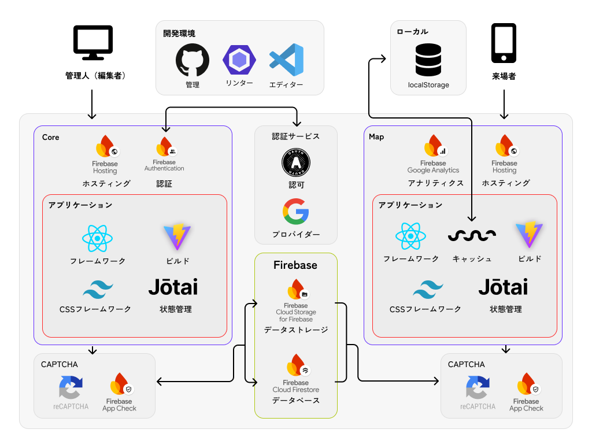

<h2 align='center'></h2>
<h1 align='center'>TANE Map</h1>

# 使用技術

## パッケージ一覧

<p align="left">


</p>

## システム構成



## その他

-   アイコン：Font Awesome 6

# 環境変数

.env ファイル

```
VITE_API_KEY="<>"
VITE_AUTH_DOMAIN="<>"
VITE_PROJECT_ID="<>"
VITE_STORAGE_BUCKET="<>"
VITE_MESSAGING_SENDER_ID="<>"
VITE_APP_ID="<>"
VITE_MEASUREMENT_ID="<>"
VITE_DATABASE_URL="<>"
VITE_RECAPTCHA_SITE_KEY="<>"
VITE_ANALYTICS_ID="<>"
```

# コマンド一覧

## 開発環境開始

```
npm run dev
```

## ビルド

```
npm run build
```

## デプロイ

```
firebase deploy --only hosting:map-tane
```
